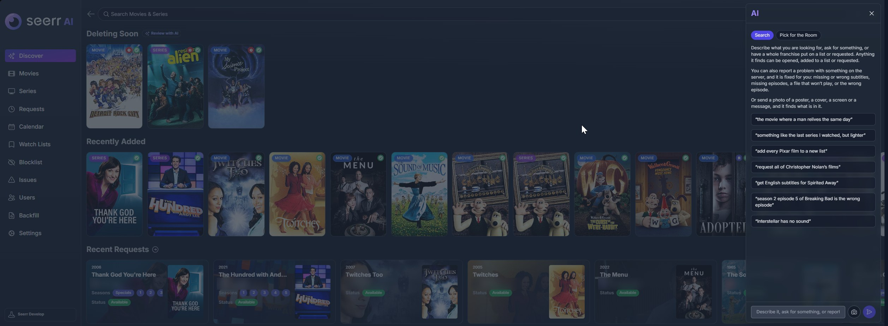
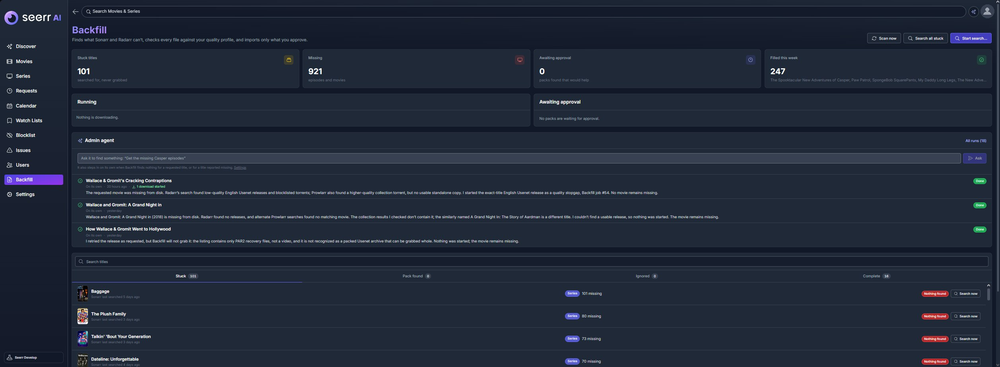
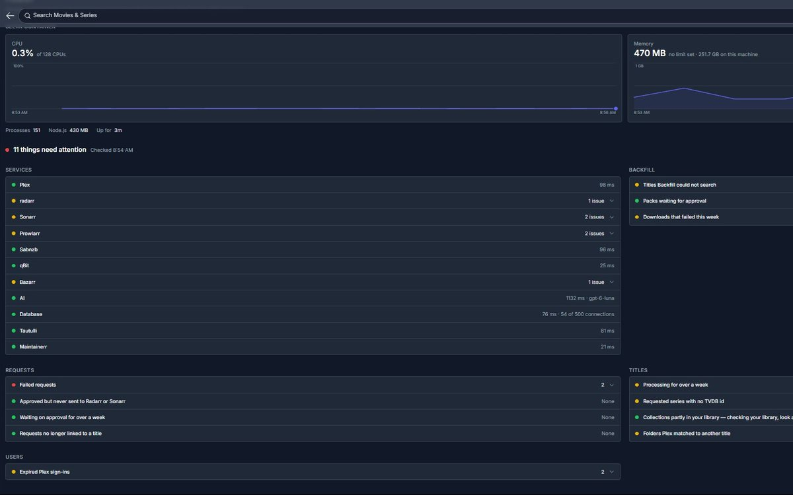
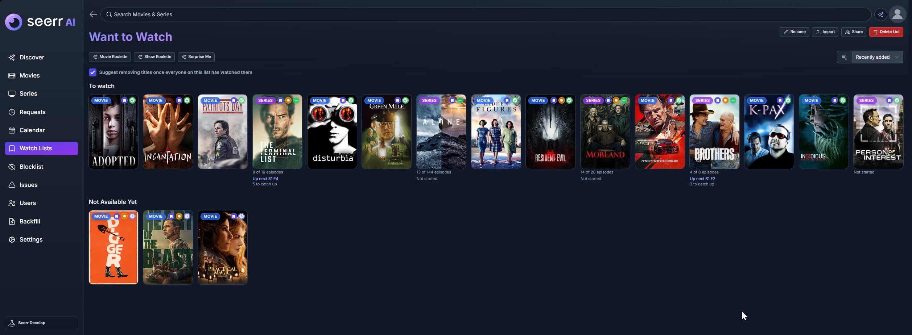
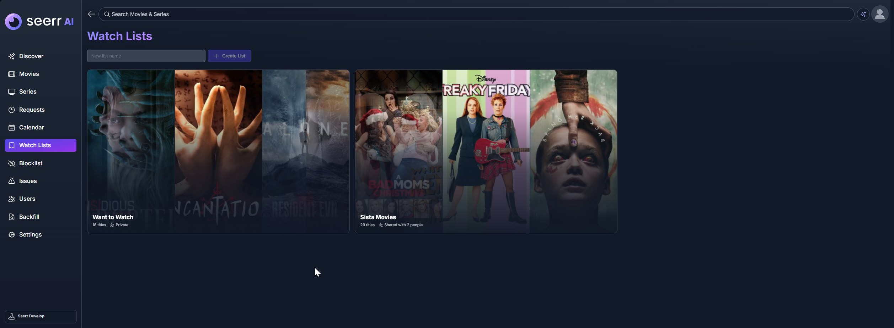
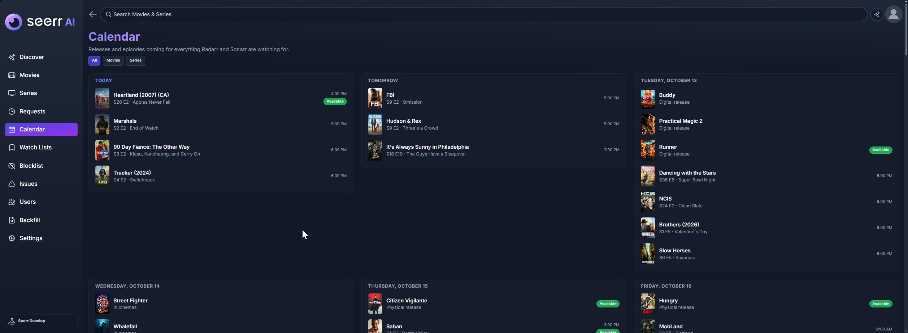

<p align="center">
  <picture>
    <source media="(prefers-color-scheme: dark)" srcset="./public/logo_ai_dark.svg">
    
  </picture>
</p>

**Seerr AI** is a fork of [Seerr](https://github.com/seerr-team/seerr), the request manager for Plex, Jellyfin and Emby libraries. It keeps everything Seerr does and adds what running a busy server actually needs:

- **Finding what Sonarr and Radarr can't.** Backfill searches Prowlarr itself for stuck titles, checks every file in a pack before anything downloads, and imports only what's missing. An AI admin agent looks further when Backfill finds nothing.
- **Saying what is going on.** Download pills say what a download is doing and why, from "Waiting: held by Sonarr's delay profile, sent in 1 h 37 min" to "Adding to Plex". Requests show when they should arrive. A Health page and alerts report problems with connected services as they happen.
- **AI where it helps**, with Claude or any OpenAI-compatible model, including one on your own hardware. AI Search finds titles from a description or a photo, Pick for the Room chooses for a group, and Catch Me Up recaps a series without spoilers. AI never acts on its own: people confirm everything.
- **Things people asked for.** Shared watch lists with "up next" for each series, a release calendar, Suggested for You, subtitles from Bazarr (and transcription with Whisper), passkeys, and a home page each person arranges for themselves.

Every addition can be switched off for everyone, or by each person for themselves.

## Screenshots

| | |
|---|---|
|  **AI Search**: describe a title, request a whole franchise, or report a problem |  **Backfill**: finds what Sonarr and Radarr can't, with the admin agent looking further |
|  **Health**: every connected service and what needs attention |  **A watch list**: what's next in each series, and what isn't out yet |
|  **Watch lists**: private, or shared with others |  **Calendar**: what's coming, and what's already here |

## What it adds

| Area | Seerr | Seerr AI |
|---|---|---|
| Stuck titles | Wait for Radarr or Sonarr to find them | **Backfill** searches Prowlarr under every name, checks each file, imports only what is approved; the **admin agent** looks further |
| Download status | "Processing" | **What it is doing**: waiting on a delay profile (and for how long), queued, stalled, verifying, unpacking, importing, adding to Plex; live progress from SABnzbd, NZBGet, qBittorrent, Transmission, Deluge and rTorrent |
| When it arrives | — | **Arrival estimates** on requests, title pages and approval notifications |
| Problems | Find them yourself | **Health page** for every connected service, with **alerts**; nightly **Plex Match Check** for folders Plex matched to the wrong title |
| AI | — | AI Search (text or photo), Pick for the Room, Catch Me Up, Review Deletions, Suggest Issue Fixes, Explain Logs, Backfill second opinion, admin agent |
| Lists | Watchlist | **Shared watch lists** with roles, activity, "up next" per series, import, Roulette, "Finished watching?" |
| Discover | Admin-arranged rows | Each person hides rows for themselves; **Suggested for You**; **Deleting Soon**; filter any poster grid; request several at once |
| Series | Request seasons | Request a **single episode**; **get new seasons as they premiere**; per-episode availability |
| Anime | — | One anime rule everywhere; anime folders, profiles and series type for Sonarr **and** Radarr; nightly Anime Check |
| Subtitles | — | See, search, replace and **transcribe** subtitles through Bazarr |
| Maintainerr | — | **Deleting Soon** badges and row, and a **Keep** button |
| Sign-in | Plex, Jellyfin, local | **Passkeys**; Plex users imported automatically and kept deleted when removed |
| Notifications | One per event | Bursts **gathered into one**; missed ones caught up; list activity, Backfill and Health notifications |
| The app | | Offline page that says what failed; startup screen; AVIF/WebP image cache; lighter pages |

The full list, with where to find each thing and how to turn it off, is in **[docs/seerr-ai](./docs/seerr-ai/README.md)**.

## Documentation

- **[Seerr AI guide](./docs/seerr-ai/README.md)**: every feature this fork adds, for people using it and for admins.
- **[Installing and updating](./docs/seerr-ai/install.md)**: building the image, applying updates, database migrations and backups.
- **[Developer notes](./docs/FORK.md)**: how the fork is built and tested, and the rules learned the hard way.
- Everything Seerr already does is documented at [docs.seerr.dev](https://docs.seerr.dev).

Inside the app, **Settings → How It Works** explains to admins how requests, downloads, Backfill and the checks fit together.

## Getting started

Seerr AI is published as a Docker image for PCs, servers and NAS boxes (amd64) and for ARM (Raspberry Pi, Apple Silicon):

```bash
docker pull ghcr.io/corruptmods/seerr-ai:latest
```

```yaml
services:
  seerr-ai:
    image: ghcr.io/corruptmods/seerr-ai:latest
    init: true
    environment:
      - TZ=America/New_York
    ports:
      - 5055:5055
    volumes:
      - ./config:/app/config
    restart: unless-stopped
```

Open port 5055 and the setup takes it from there: sign in with Plex, Jellyfin or Emby, connect Radarr and Sonarr. Nothing from Seerr needs to be installed first. It can also take over an existing Seerr database, adding its own tables when it starts; back the database up first.

See **[Installing and updating](./docs/seerr-ai/install.md)** for PostgreSQL, updating, building it yourself, and what to connect after installing.

## API

The API, including everything Seerr AI adds, is described in [seerr-api.yml](./seerr-api.yml) and served at `/api-docs` on a running install.

## Credits and licence

Seerr AI is built on [Seerr](https://github.com/seerr-team/seerr) and the Overseerr and Jellyseerr projects before it, and on their contributors' work. It is released under the same [MIT licence](./LICENSE).

This fork is maintained separately. Please don't report its problems to the Seerr project.
