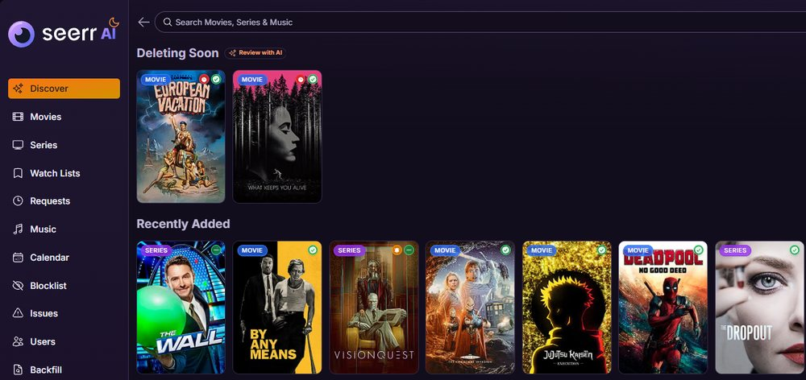
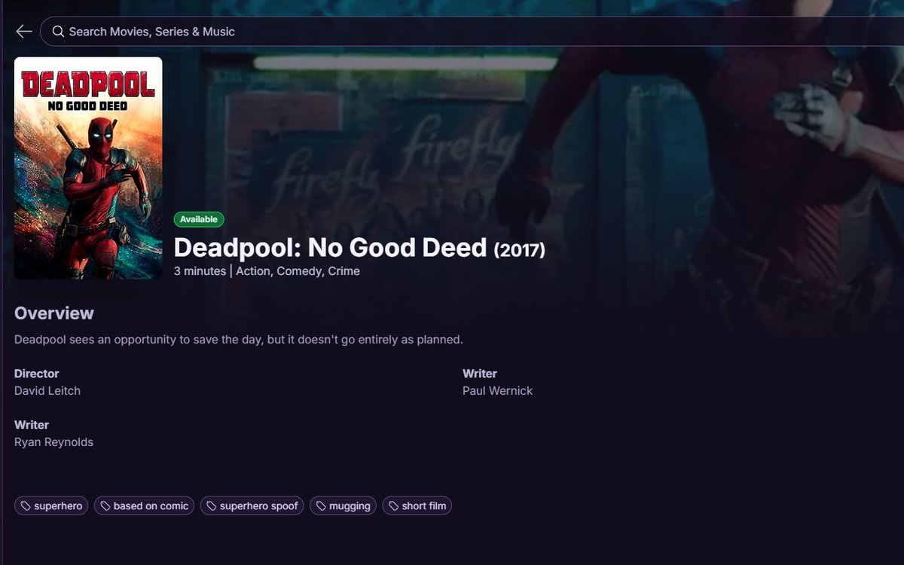
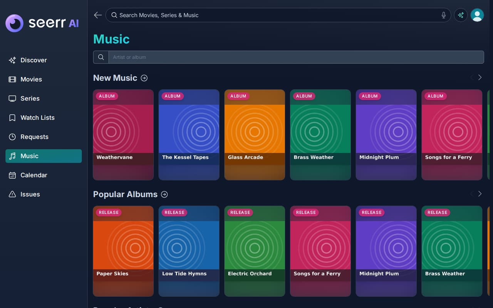
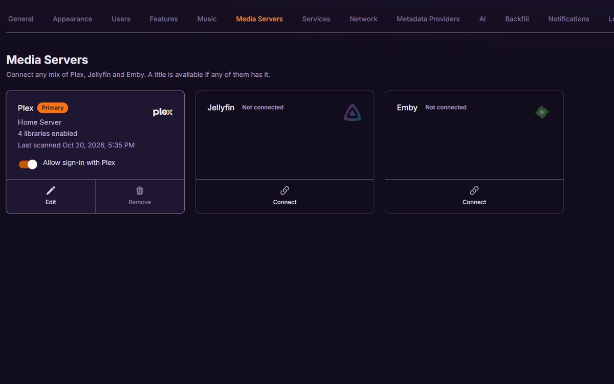
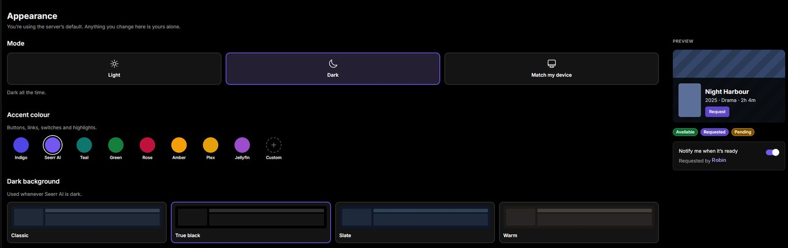
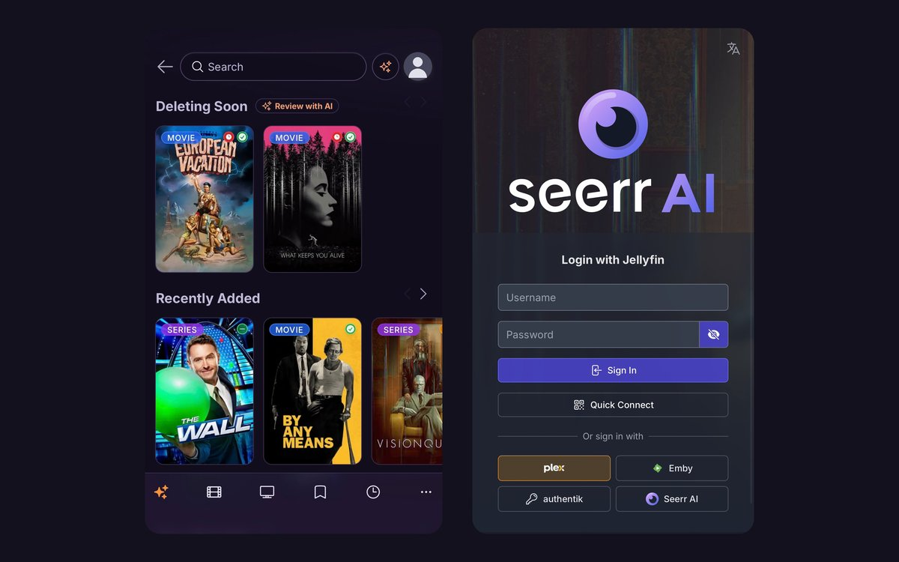

<p align="center">
  <picture>
    <source media="(prefers-color-scheme: dark)" srcset="./public/logo_ai_dark.svg">
    
  </picture>
</p>

**Seerr AI** is a request manager for Plex, Jellyfin and Emby: people find films, series and music and ask for them, and it gets them through Radarr, Sonarr and Lidarr. It is a fork of [Seerr](https://github.com/seerr-team/seerr) and keeps everything Seerr does.

## What it does

**Requests and discovery**
- Request films, series, single seasons or single episodes; get new seasons as they premiere.
- Status that says what a download is doing and when it should arrive.
- Discover rows each person arranges, Suggested for You, an Anime page, filters that can leave out streaming services.
- Shared watch lists with "up next" for each series, a release calendar, Roulette; playlists that bring in a Spotify or Apple Music playlist and request its songs.

**Media servers**
- Plex, Jellyfin and Emby, one or all three at once. Available on any counts; Play on each.
- Match Check finds titles a server matched wrongly, nightly and as requests arrive.

**Music**
- Request albums, a whole discography, or just one song (the radio edit or the club mix) through Lidarr.
- Top Songs, Trending Songs, Top Albums and Top Artists from Apple Music's charts, and rows of your own from the music you ask for.
- Backfill and the admin agent go after albums Lidarr couldn't find.

**Sign-in**
- Plex, Jellyfin, Emby, a password, passkeys, or single sign-on (Authentik, Authelia, Keycloak, Pocket ID, Google).
- Personal API keys for apps and scripts.

**AI** (optional: Claude, OpenAI or a model on your own hardware)
- AI Search for films, series and music, from a description or a photo; Pick for the Room; spoiler-free Catch Me Up.
- Tell it what's wrong ("missing episodes", "no subtitles", "this album is missing songs") and it sets about fixing it. Siri can report what's playing.
- An admin agent that finds what Sonarr, Radarr and Lidarr can't, and changes nothing without approval.

**Admin tools**
- Backfill: searches Prowlarr for stuck titles and albums, and imports only what's missing.
- Download Check: catches fake and wrong downloads and stuck imports.
- A Health page with alerts, and live progress from six download clients.
- Subtitles through Bazarr, transcribed with Whisper when none can be found, showing what Bazarr is doing as it works.
- Works with Radarr 7.

**Everywhere**
- Installs as an app on a phone, and comes back to the page you were on.
- Light and dark themes, accent colours and custom CSS; 40 languages.

Every extra can be turned off for everyone, or by each person for themselves.

## Screenshots

| | |
|---|---|
| <br>**AI Search**: describe a title, request a franchise or report a problem | <br>**Backfill**: finds what Sonarr and Radarr can't |
| <br>**Health**: every service and what needs attention | <br>**Calendar**: what's coming |
| <br>**Discover** | <br>**A title page** |
| <br>**Music**, requested through Lidarr | <br>**Media Servers**: Plex, Jellyfin and Emby, in any mix |
| <br>**Appearance**: everyone picks their own look | <br>**On a phone**, with every way to sign in |

## Install

```yaml
services:
  seerr-ai:
    image: ghcr.io/corruptmods/seerr-ai:latest
    init: true
    environment:
      - TZ=America/New_York
    ports:
      - 5055:5055
    volumes:
      - ./config:/app/config
    restart: unless-stopped
```

Open port 5055 and follow the setup. Images are for amd64 and arm64. It can also take over an existing Seerr database: back it up first. [Installing and updating](./docs/seerr-ai/install.md) covers PostgreSQL, updates and building it yourself.

## Documentation

- **[Seerr AI guide](./docs/seerr-ai/README.md)**: every feature, for people using it and for admins.
- **[What's new](./CHANGELOG.md)**: each release.
- **[Developer notes](./docs/FORK.md)**: building, testing and the fork's rules.
- **API**: [seerr-api.yml](./seerr-api.yml), also served at `/api-docs`.
- What Seerr already does: [docs.seerr.dev](https://docs.seerr.dev).

## Credits and licence

Seerr AI is built on [Seerr](https://github.com/seerr-team/seerr) and the Overseerr and Jellyseerr projects before it. It is released under the same [MIT licence](./LICENSE). Please report its problems [here](https://github.com/corruptmods/SeerrAI/issues), not to the Seerr project.
