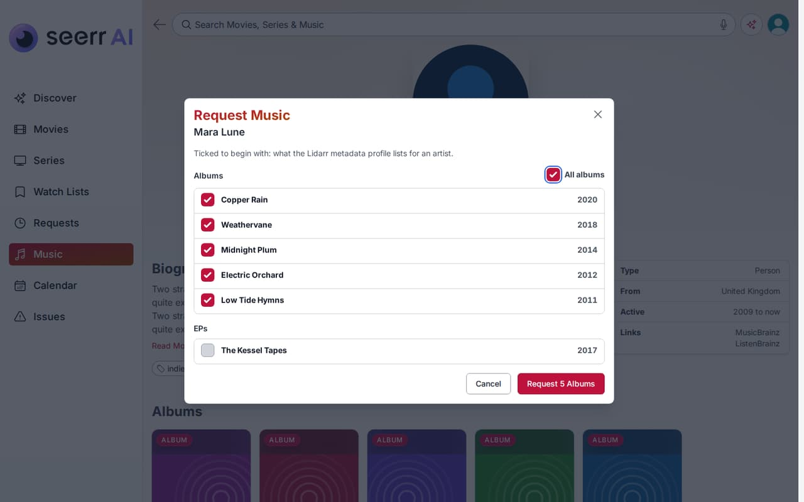
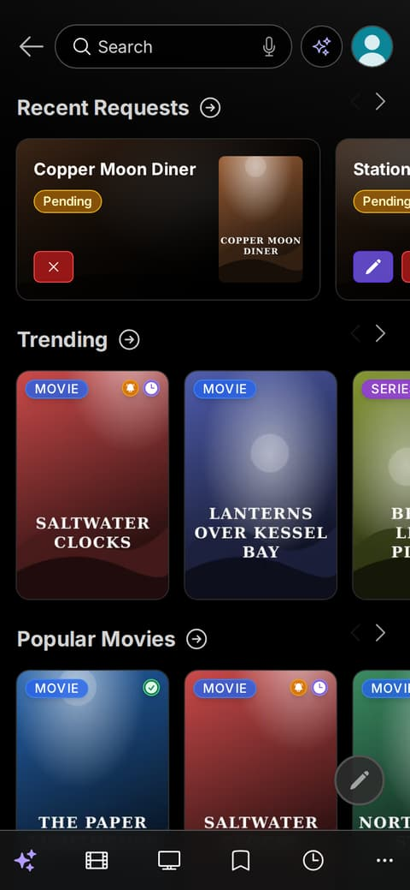
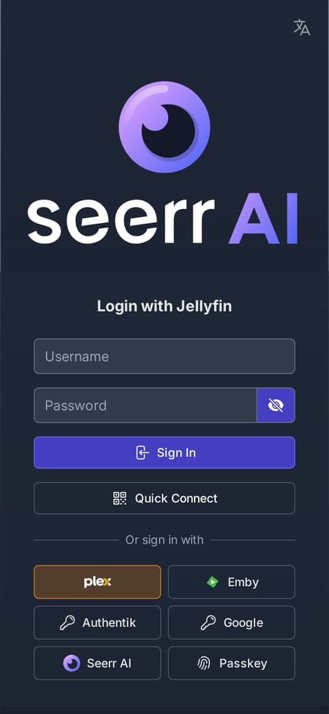

<p align="center">
  <picture>
    <source media="(prefers-color-scheme: dark)" srcset="./public/logo_ai_dark.svg">
    
  </picture>
</p>

**Seerr AI** is a request manager for Plex, Jellyfin and Emby: people find films, series and music and ask for them, and it gets them through Radarr, Sonarr and Lidarr. It is a fork of [Seerr](https://github.com/seerr-team/seerr) and keeps everything Seerr does.

## What it does

**Requests and discovery**
- Request films, series, single seasons or single episodes; get new seasons as they premiere.
- Status that says what a download is doing and when it should arrive.
- Discover rows each person arranges, Suggested for You, an Anime page, filters that can leave out streaming services.
- Shared watch lists with "up next" for each series, a release calendar, Roulette.

**Media servers**
- Plex, Jellyfin and Emby, one or all three at once. Available on any counts; Play on each.
- Match Check finds titles a server matched wrongly, nightly and as requests arrive.

**Music**
- Request albums or a whole discography through Lidarr, as one request.

**Sign-in**
- Plex, Jellyfin, Emby, a password, passkeys, or single sign-on (Authentik, Authelia, Keycloak, Pocket ID, Google).
- Personal API keys for apps and scripts.

**AI** (optional: Claude, OpenAI or a model on your own hardware)
- AI Search from a description or a photo, Pick for the Room, spoiler-free Catch Me Up.
- An admin agent that finds what Sonarr and Radarr can't, and changes nothing without approval.

**Admin tools**
- Backfill: searches Prowlarr for stuck titles and imports only what's missing.
- A Health page with alerts, live progress from six download clients, subtitles through Bazarr.
- Light and dark themes, accent colours and custom CSS; 40 languages.

Every extra can be turned off for everyone, or by each person for themselves.

## Screenshots

| | |
|---|---|
|  **Discover**, in light mode |  **A title on three servers**: Play on each |
|  **Music**: new and popular albums |  **Requesting music**: pick albums, one request |
|  **Media Servers**: connect, choose the primary one |  **Appearance**: everyone picks their own look |
|  **On a phone** |  **Signing in**, single sign-on included |

## Install

```yaml
services:
  seerr-ai:
    image: ghcr.io/corruptmods/seerr-ai:latest
    init: true
    environment:
      - TZ=America/New_York
    ports:
      - 5055:5055
    volumes:
      - ./config:/app/config
    restart: unless-stopped
```

Open port 5055 and follow the setup. Images are for amd64 and arm64. It can also take over an existing Seerr database: back it up first. [Installing and updating](./docs/seerr-ai/install.md) covers PostgreSQL, updates and building it yourself.

## Documentation

- **[Seerr AI guide](./docs/seerr-ai/README.md)**: every feature, for people using it and for admins.
- **[What's new](./CHANGELOG.md)**: each release.
- **[Developer notes](./docs/FORK.md)**: building, testing and the fork's rules.
- **API**: [seerr-api.yml](./seerr-api.yml), also served at `/api-docs`.
- What Seerr already does: [docs.seerr.dev](https://docs.seerr.dev).

## Credits and licence

Seerr AI is built on [Seerr](https://github.com/seerr-team/seerr) and the Overseerr and Jellyseerr projects before it. It is released under the same [MIT licence](./LICENSE). Please report its problems [here](https://github.com/corruptmods/SeerrAI/issues), not to the Seerr project.
